# Ginjer Panel

Tools for running a sharded [Nodes](https://github.com/ginjerul/ginjer-nodes) Minecraft network on [Pelican Panel](https://pelican.dev): a Velocity proxy in front, several [Reef](https://github.com/ginjerul/reef) shards that split one world between them, and a Redis that Nodes uses to keep the shards in sync.

This is not a fork of the panel. It's a Pelican **plugin** plus **eggs**, so you run normal Pelican and keep getting its updates and security fixes.

| Folder | What it is |
|---|---|
| `plugins/ginjer-network/` | The **Ginjer Network** plugin for the admin area |
| `eggs/egg-reef-shard.yaml` | Egg for one Reef shard with Nodes and GinjerMap |

## Ginjer Network plugin

Under **Ginjer → Networks** in the admin area, a network groups the servers that belong together:

- **Servers:** add the Velocity proxy, every Reef shard (each with its shard name, as in `velocity.toml`) and Redis. Mark one shard as the **Nodes leader**.
- **Power:** start, stop, restart or kill the whole network in the right order. Start goes Redis, then the leader, then the other shards, then the proxy. Stop goes the other way round, so players leave first and the leader saves last.
- **Push config to shards:** writes the `sharding` section of `reef.yml` (the same regions everywhere, each shard's own `this-server`) and of `plugins/nodes/config.yml` (leader or follower, shard name, Redis) on every shard. Nodes' config keeps all its comments. Before pushing, it checks that the regions are valid, that every shard owns an area and that there's exactly one leader.
- **Status:** for each shard, its state, Nodes role, TPS and time per tick, players, memory and CPU. It also shows the shard that holds the Nodes leader lock in Redis, and warns when that isn't the leader set in the panel (after a failover). TPS and tick time need a Nodes version that reports them.
- **Health checks:** every minute, root admins get a notification when a shard goes down, stops syncing with Nodes, or stays below a TPS threshold for a few minutes, plus one when it recovers. A lagging shard can optionally be restarted. Planned restarts (updates, backups) don't raise alarms. Set it up under **Health checks** on the network.
- **Update shards:** downloads the newest Reef (Reef's `dev-main` release by default), Nodes and GinjerMap (a release of your Nodes repository; a private one needs a GitHub token, stored encrypted) once. It uploads them to every shard, then restarts the shards one at a time, followers first and the leader last, waiting for each to come back. Every upload finishes before anything restarts, and a shard that doesn't come back stops the rollout. **Power → Rolling restart** does the same without updating.
- **Plugins:** switch a plugin on or off on every shard at once. It shows shards that disagree, or are missing a jar.
- **Backups:** saves Nodes and the worlds and snapshots Redis, then backs up every server at the same moment as one network backup. Restore puts every server back to that moment. It keeps the last few network backups and can run every few hours.
- **Promote now:** runs `nda shards promote` on a follower when the leader is down.
- **Velocity servers:** the `[servers]` lines for the proxy's `velocity.toml`. With a proxy in the network, **Push config** writes them for you. It also keeps every comment, puts the leader first in `try`, drops the sample forced hosts that would stop Velocity from starting, sets forwarding to `modern`, and gives every shard the proxy's `forwarding.secret` (through the egg's `VELOCITY_SECRET` and in `paper-global.yml`). Shards on the proxy's node that listen on every interface are reached through Wings' Docker gateway (`GINJER_NETWORK_DOCKER_GATEWAY`, default `172.18.0.1`), and shards on other nodes through their node's address.


| Status | Power |
|---|---|
|  | 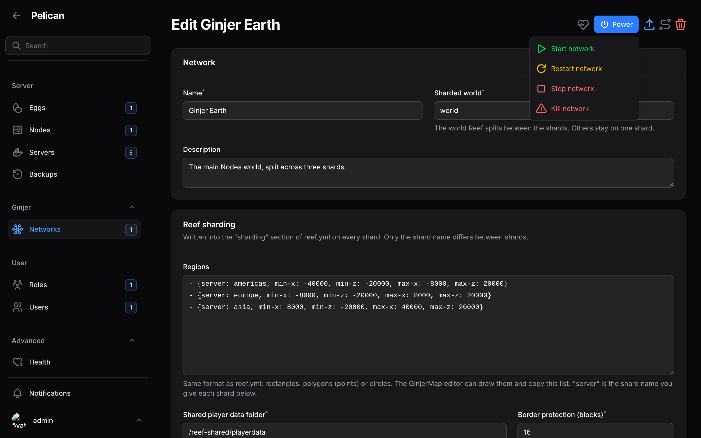 |
| **Push config to shards** | **Velocity servers** |
|  | 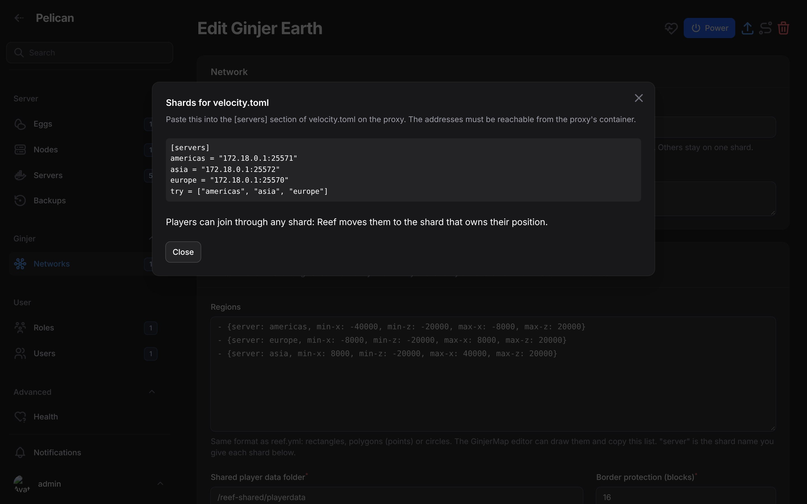 |
| **Shard health** | **Update shards** |
| 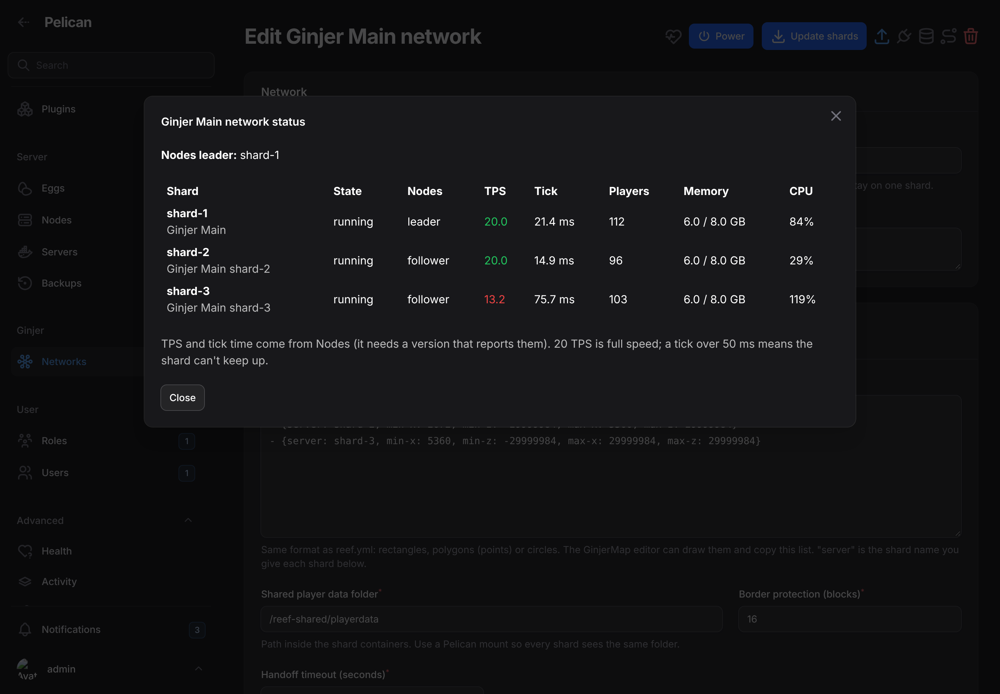 | 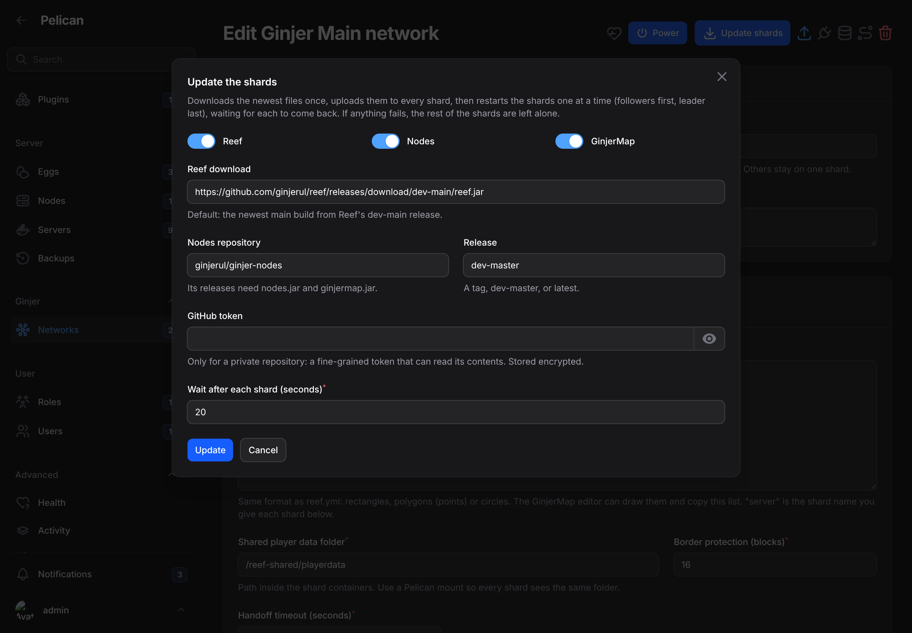 |
| **Plugins on every shard** | **Network backups** |
| 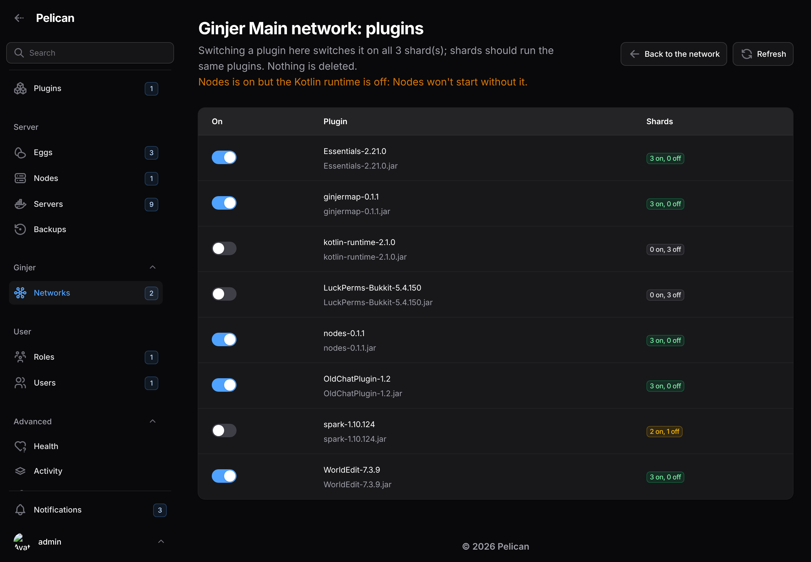 | 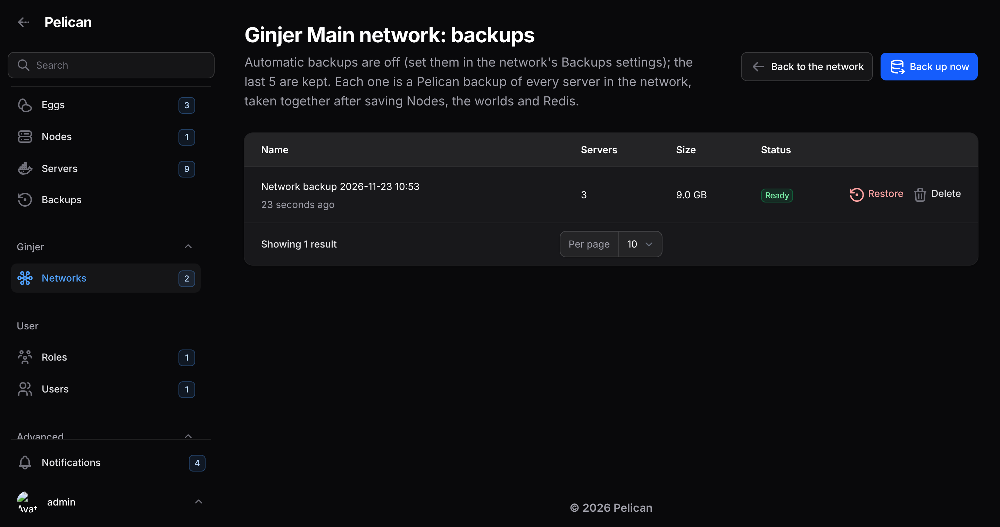 |

The screenshots come from a test panel with sample data.

### Split a server into shards

**Ginjer → Networks → Split a server into shards** turns one server into a sharded network:

1. **Pick** the server, the players you expect at peak, and optionally the number of shards (by default about 100 players each) and the nodes the new shards may use.
2. **Plan.** It reads Nodes' `world.json` and `towns.json` from the server and splits the world into rectangles holding about the same number of players. Every claimed chunk counts, and more for towns with more residents. Each cut goes across the longer side, on a chunk border, and the outer regions reach the edge of the world, so no spot is left without a shard. RAM per shard is about 2 GB plus 48 MB per expected player, between 3 and 16 GB, with 1.5 GB extra for the leader. Each new shard goes on the chosen node with the most free memory and a free port. Without Nodes data, the area around spawn is split evenly.
3. **Review** the shards, their areas, players, RAM, node and address. Rename them or change their RAM. Then choose your Redis and proxy servers, or let the split create them from installed eggs (for example the community `Redis-7` and `Velocity` eggs). Redis gets a generated password, and the proxy is started once, configured and restarted.
4. **Split.** In the background, it creates a copy of the server for each new shard (same egg, startup and variables, RAM as planned). It packs the original's files (not the Nether, End, logs or cache), and every new shard downloads and unpacks them through a signed link, so this also works across nodes. Then it gives the original its planned RAM, creates the network and pushes the Reef and Nodes settings. The result appears in your notifications.

The original server must be stopped while it's copied. It becomes the Nodes leader and keeps the area around spawn, plus the Nether and the End. Everyone's inventory and position move into Reef's shared player data folder by themselves the first time the shards start (Reef copies `world/playerdata` there, never overwriting).

If a node's address is a private IP, Wings refuses to download from it. Add that address under `api.remote_download.allowlist` in the Wings `config.yml` of the nodes that get new shards.

| Pick a server | The plan |
|---|---|
| 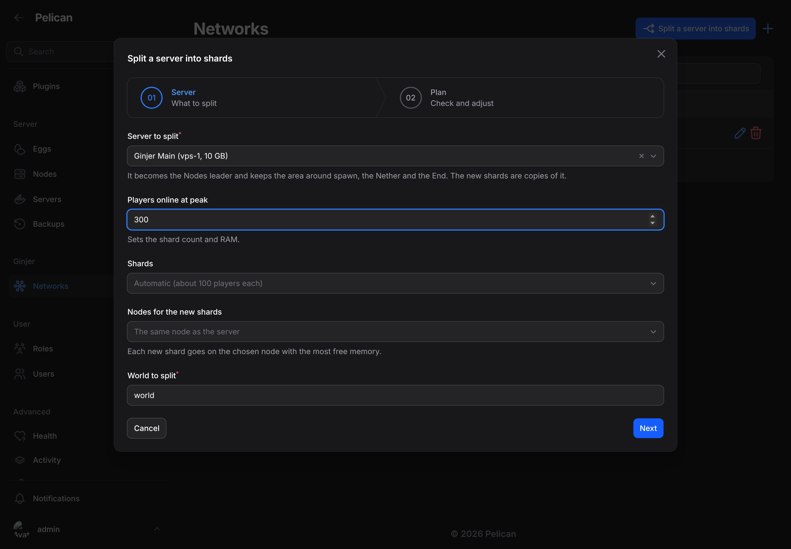 | 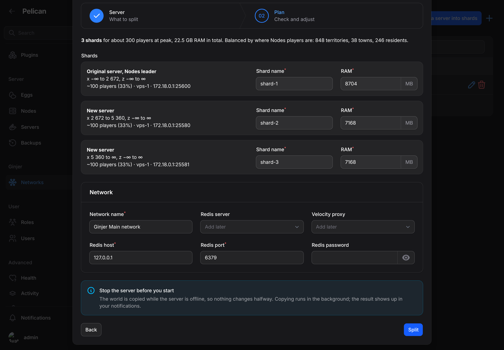 |

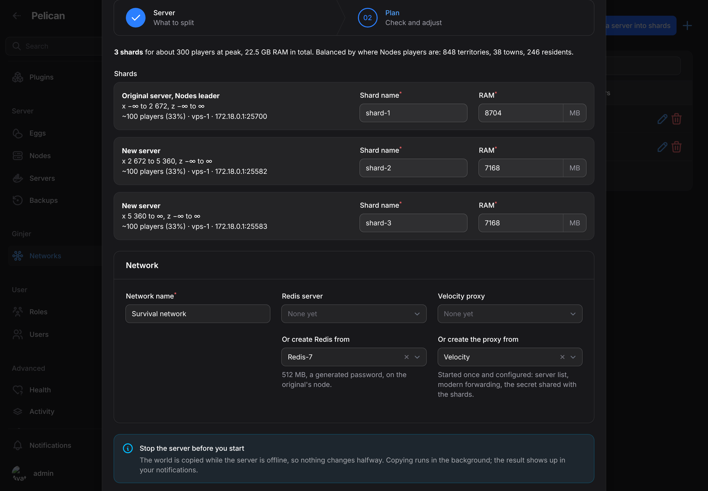

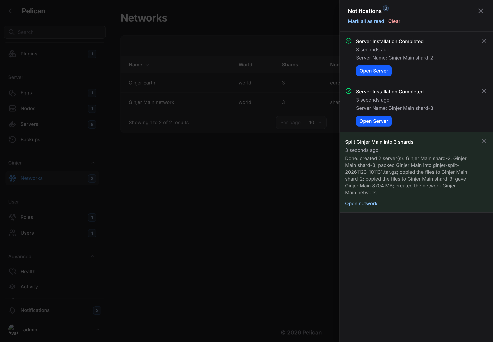

### Install

1. Download this repository as a zip, then upload the `plugins/ginjer-network` folder as a zip in **Admin → Plugins → Import**, or copy the folder into the panel's `plugins/` directory.
2. Install it in **Admin → Plugins**. That creates its two database tables.
3. The power buttons, updates, backups and splits run in the background through Laravel's queue, and the health checks and scheduled backups run on Laravel's scheduler. A standard Pelican install runs both (the queue worker and the `schedule:run` cron).

Settings (optional, in the panel's `.env`):

| Setting | Default | |
|---|---|---|
| `GINJER_NETWORK_START_STAGE_DELAY` | `10` | Seconds between start or stop stages |
| `GINJER_NETWORK_REEF_CONFIG` | `reef.yml` | Reef's config file, relative to the server folder |
| `GINJER_NETWORK_NODES_CONFIG` | `plugins/nodes/config.yml` | Nodes' config file |
| `GINJER_NETWORK_REDIS_TIMEOUT` | `2` | Seconds to wait for Redis when reading the status |

## Server pages

The plugin also adds two pages to every server's own panel. Both need the "file update" permission on that server.

### Performance

Reads the server's `server.properties`, `bukkit.yml`, `spigot.yml`, `config/paper-world-defaults.yml`, `reef.yml`, Nodes' `config.yml` and Java start-up flags. For each recommended setting it shows the current value, the recommended one and why.

- **Balanced** only changes things players barely notice. Examples: smoother auto-saves, capped junk entities per chunk, faster explosions and redstone, item merging, Aikar's garbage collector flags.
- **Performance** also trades some gameplay for speed: shorter view and simulation distance, lower mob limits, brainless spawner mobs and so on. Every change players may notice is marked.
- Tick the ones you want, or **Apply all**. The files are backed up in the panel first, and **Undo last apply** puts them back. Changes take effect after a restart (there's a Restart button).
- It knows what each server is. Reef and Nodes settings only appear where they're installed. Turning off compression only appears for servers behind a Velocity proxy, and shard sync batching only for the Nodes leader.
- It never turns off Paper's hopper move event on a server with Nodes. Nodes uses that event to stop hoppers draining protected town chests.
- Java flags keep every flag they don't manage, such as `-Dterminal.jline=false` for the console. The heap is capped at 85% of the server's memory so Java's memory outside the heap fits in the container. Changing the start-up command also needs the "startup update" permission.

The setting names and defaults were checked against the source of Paper 1.21.11 (the commit Reef is built on), Reef and Nodes.

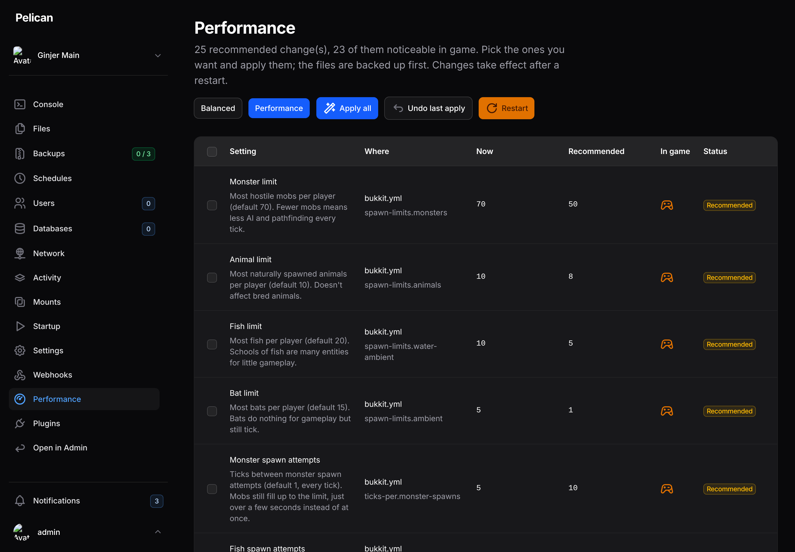

**Tools** (needs console access):
- **Pre-generate the map:** Chunky generates the chunks within a radius of 0, 0 ahead of time, so exploring doesn't lag. On a shard, only the part it owns is generated.
- **Profile with spark:** a 60-second profile, then a notification with the link.

Both install the plugin from Modrinth the first time; restart the server so it loads, then use them.

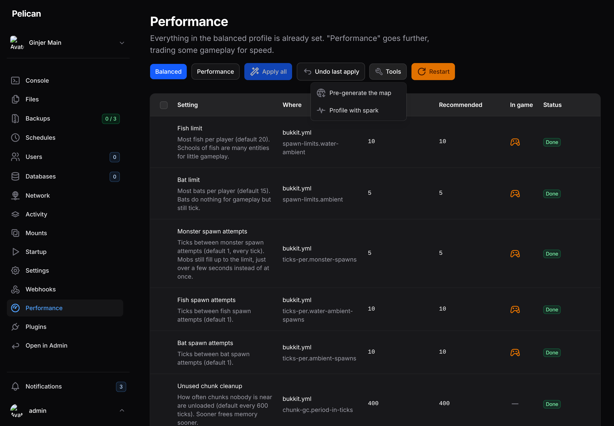

### Plugins

Every jar in `plugins/` with an on/off switch. Off renames `X.jar` to `X.jar.disabled`, so the server skips it. On renames it back. Nothing is deleted and the plugin's data folder stays. It warns when a switch breaks the Nodes stack, for example Nodes on but the Kotlin runtime off. Changes take effect after a restart.

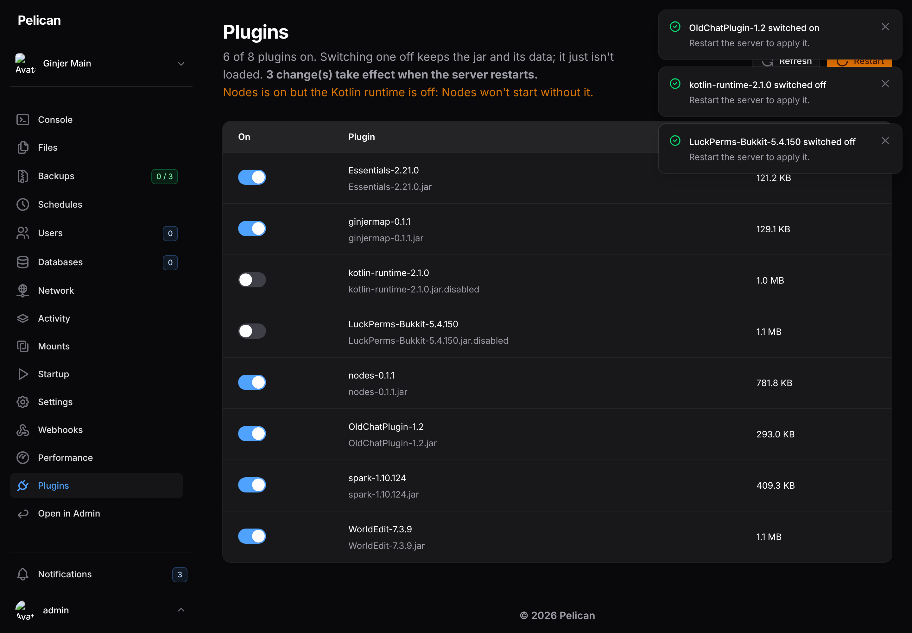

## Setting up a sharded network

1. **Redis:** create a server from a Redis egg (for example the one in [pelican-eggs/database](https://github.com/pelican-eggs/database)) and give it a password.
2. **Proxy:** create a Velocity server (Pelican's Velocity egg). Note its forwarding secret.
3. **Shared player data:** in **Admin → Mounts**, create a mount from a host folder such as `/srv/reef-shared` to `/reef-shared` in the containers. Attach it to the shard egg and the node. Reef keeps every player's inventory and position there, so all shards must see the same folder. Shards on different machines need a network share at that host path.
4. **Shards:** import `eggs/egg-reef-shard.yaml` in **Admin → Eggs → Import** and create one server per shard. Set the same Velocity secret on each, plus a GitHub token if your Nodes repository is private. Give each shard a copy of the **same world folder, including `uid.dat`**.
5. Start every shard once so Reef and Nodes create their config files, then stop them.
6. **Network:** in **Ginjer → Networks**, create a network, paste the regions and the Redis address, and add the servers. Mark one shard as the leader.
7. Start the proxy once so Velocity creates its files, then **Push config to shards** (it fills in the proxy's `velocity.toml` too) and **Power → Start network**.

See Reef's `SHARDING.md` and Nodes' `SHARDING-DESIGN.md` for what sharding does and its limits.

### The Reef shard egg

The installer downloads:

- **Reef** from `REEF_JAR_URL`. The default is the newest `main` build, from Reef's `dev-main` release. Leave it empty to upload your own jar as `server.jar`.
- **Nodes and GinjerMap** (`nodes.jar`, `ginjermap.jar`) from a release of `NODES_REPO`. The default is `dev-master` of `ginjerul/ginjer-nodes`. A private repository needs `GITHUB_TOKEN`, a fine-grained token with read access to that repository's contents.
- **The Kotlin runtime** Nodes needs, from `KOTLIN_RUNTIME_URL`, if set.

Each time a shard starts, Pelican sets the shard's port, `online-mode=false` and Velocity modern forwarding with the secret in `config/paper-global.yml`.

## Tests

Every push runs all of the tests below on GitHub Actions (`.github/workflows/tests.yml`), inside a real Pelican install. `tests/fixtures/nodes-world.json` and `nodes-towns.json` are a made-up Nodes world (12 towns) for the split tests.

The region checks and the Nodes config editor run without a panel:

```bash
php plugins/ginjer-network/tests/services-test.php <panel>/vendor/autoload.php [path/to/nodes/config.yml]
```

The optimizer (on the config files in `tests/fixtures/`, plus Nodes' real `config.yml` if you pass it) and the split maths (coverage, balance, chunk borders, RAM rules) run without a panel too. The autoloader needs `symfony/yaml` and `illuminate/collections`, which a panel's `vendor/autoload.php` has:

```bash
php plugins/ginjer-network/tests/optimizer-test.php <vendor/autoload.php> [path/to/nodes/config.yml]
php plugins/ginjer-network/tests/velocity-test.php
php plugins/ginjer-network/tests/health-test.php
php plugins/ginjer-network/tests/tools-test.php <vendor/autoload.php>
```


```bash
php plugins/ginjer-network/tests/split-test.php <vendor/autoload.php> [world.json towns.json]
```

The end-to-end tests run inside a real panel with the plugin installed, with Wings faked. It creates a node, servers and a network inside a database transaction and rolls everything back at the end:

```bash
cd <panel>
php plugins/ginjer-network/tests/panel-test.php [path/to/nodes/config.yml]
php plugins/ginjer-network/tests/ops-panel-test.php
GINJER_EGG=<repo>/eggs/egg-reef-shard.yaml php plugins/ginjer-network/tests/split-panel-test.php <world.json> <towns.json>
```

## License

[AGPL-3.0](LICENSE), like Pelican Panel. If you change this plugin and let other people use your panel, you must offer them the changed source.
