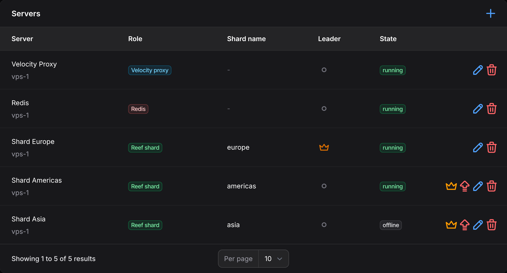
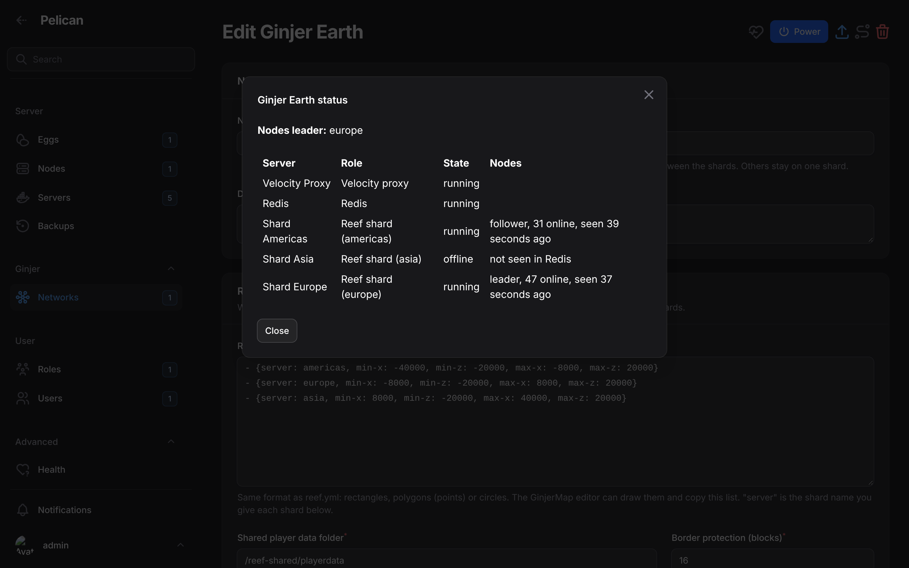
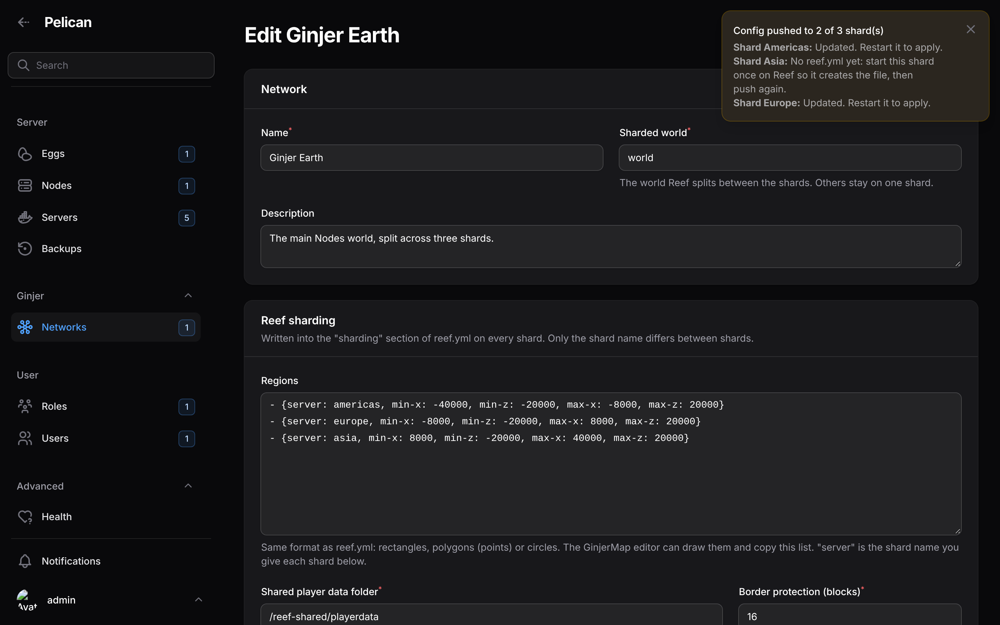

# Ginjer Panel

Tools for running a sharded [Nodes](https://github.com/ginjerul/ginjer-nodes) Minecraft network on [Pelican Panel](https://pelican.dev): a Velocity proxy in front, several [Reef](https://github.com/ginjerul/reef) shards that split one world between them, and a Redis that Nodes uses to keep the shards in sync.

This is not a fork of the panel. It's a Pelican **plugin** plus **eggs**, so you run normal Pelican and keep getting its updates and security fixes.

| Folder | What it is |
|---|---|
| `plugins/ginjer-network/` | The **Ginjer Network** plugin for the admin area |
| `eggs/egg-reef-shard.yaml` | Egg for one Reef shard with Nodes and GinjerMap |

## Ginjer Network plugin

Under **Ginjer → Networks** in the admin area, a network groups the servers that belong together:

- **Servers:** add the Velocity proxy, every Reef shard (each with its shard name, as in `velocity.toml`) and Redis. Mark one shard as the **Nodes leader**.
- **Power:** start, stop, restart or kill the whole network in the right order. Start goes Redis, then the leader, then the other shards, then the proxy. Stop goes the other way round, so players leave first and the leader saves last.
- **Push config to shards:** writes the `sharding` section of `reef.yml` (the same regions everywhere, each shard's own `this-server`) and of `plugins/nodes/config.yml` (leader or follower, shard name, Redis) on every shard. Nodes' config keeps all its comments. Before pushing, it checks that the regions are valid, that every shard owns an area and that there's exactly one leader.
- **Status:** each server's state, the shard that holds the Nodes leader lock in Redis, and each shard's role and player count as Nodes reports them. It warns when the lock holder isn't the leader set in the panel (after a failover).
- **Promote now:** runs `nda shards promote` on a follower when the leader is down.
- **Velocity servers:** the `[servers]` lines for the proxy's `velocity.toml`.



| Status | Power |
|---|---|
|  |  |
| **Push config to shards** | **Velocity servers** |
|  |  |

The screenshots come from a test panel with sample data.

### Split a server into shards

**Ginjer → Networks → Split a server into shards** turns one server into a sharded network:

1. **Pick** the server, the players you expect at peak, and optionally the number of shards (by default about 100 players each) and the nodes the new shards may use.
2. **Plan.** It reads Nodes' `world.json` and `towns.json` from the server and splits the world into rectangles holding about the same number of players. Every claimed chunk counts, and more for towns with more residents. Each cut goes across the longer side, on a chunk border, and the outer regions reach the edge of the world, so no spot is left without a shard. RAM per shard is about 2 GB plus 48 MB per expected player, between 3 and 16 GB, with 1.5 GB extra for the leader. Each new shard goes on the chosen node with the most free memory and a free port. Without Nodes data, the area around spawn is split evenly.
3. **Review** the shards, their areas, players, RAM, node and address. Rename them or change their RAM, then choose the Redis and proxy servers if you have them.
4. **Split.** In the background, it creates a copy of the server for each new shard (same egg, startup and variables, RAM as planned). It packs the original's files (not the Nether, End, logs or cache), and every new shard downloads and unpacks them through a signed link, so this also works across nodes. Then it gives the original its planned RAM, creates the network and pushes the Reef and Nodes settings. The result appears in your notifications.

The original server must be stopped while it's copied. It becomes the Nodes leader and keeps the area around spawn, plus the Nether and the End.

If a node's address is a private IP, Wings refuses to download from it. Add that address under `api.remote_download.allowlist` in the Wings `config.yml` of the nodes that get new shards.

| Pick a server | The plan |
|---|---|
|  |  |


### Install

1. Download this repository as a zip, then upload the `plugins/ginjer-network` folder as a zip in **Admin → Plugins → Import**, or copy the folder into the panel's `plugins/` directory.
2. Install it in **Admin → Plugins**. That creates its two database tables.
3. The power buttons start servers a few seconds apart through Laravel's queue, so the panel's queue worker must be running. It is on a standard Pelican install.

Settings (optional, in the panel's `.env`):

| Setting | Default | |
|---|---|---|
| `GINJER_NETWORK_START_STAGE_DELAY` | `10` | Seconds between start or stop stages |
| `GINJER_NETWORK_REEF_CONFIG` | `reef.yml` | Reef's config file, relative to the server folder |
| `GINJER_NETWORK_NODES_CONFIG` | `plugins/nodes/config.yml` | Nodes' config file |
| `GINJER_NETWORK_REDIS_TIMEOUT` | `2` | Seconds to wait for Redis when reading the status |

## Setting up a sharded network

1. **Redis:** create a server from a Redis egg (for example the one in [pelican-eggs/database](https://github.com/pelican-eggs/database)) and give it a password.
2. **Proxy:** create a Velocity server (Pelican's Velocity egg). Note its forwarding secret.
3. **Shared player data:** in **Admin → Mounts**, create a mount from a host folder such as `/srv/reef-shared` to `/reef-shared` in the containers. Attach it to the shard egg and the node. Reef keeps every player's inventory and position there, so all shards must see the same folder. Shards on different machines need a network share at that host path.
4. **Shards:** import `eggs/egg-reef-shard.yaml` in **Admin → Eggs → Import** and create one server per shard. Set the same Velocity secret on each, plus a GitHub token if your Nodes repository is private. Give each shard a copy of the **same world folder, including `uid.dat`**.
5. Start every shard once so Reef and Nodes create their config files, then stop them.
6. **Network:** in **Ginjer → Networks**, create a network, paste the regions and the Redis address, and add the servers. Mark one shard as the leader.
7. **Push config to shards**, paste the **Velocity servers** lines into the proxy's `velocity.toml`, then **Power → Start network**.

See Reef's `SHARDING.md` and Nodes' `SHARDING-DESIGN.md` for what sharding does and its limits.

### The Reef shard egg

The installer downloads:

- **Reef** from `REEF_JAR_URL`. The default is the newest `main` build, from Reef's `dev-main` release. Leave it empty to upload your own jar as `server.jar`.
- **Nodes and GinjerMap** (`nodes.jar`, `ginjermap.jar`) from a release of `NODES_REPO`. The default is `dev-master` of `ginjerul/ginjer-nodes`. A private repository needs `GITHUB_TOKEN`, a fine-grained token with read access to that repository's contents.
- **The Kotlin runtime** Nodes needs, from `KOTLIN_RUNTIME_URL`, if set.

Each time a shard starts, Pelican sets the shard's port, `online-mode=false` and Velocity modern forwarding with the secret in `config/paper-global.yml`.

## Tests

The region checks and the Nodes config editor run without a panel:

```bash
php plugins/ginjer-network/tests/services-test.php <panel>/vendor/autoload.php [path/to/nodes/config.yml]
```

The split maths (coverage, balance, chunk borders, RAM rules) runs without a panel too:

```bash
php plugins/ginjer-network/tests/split-test.php <vendor/autoload.php> [world.json towns.json]
```

The end-to-end tests run inside a real panel with the plugin installed, with Wings faked. It creates a node, servers and a network inside a database transaction and rolls everything back at the end:

```bash
cd <panel>
php plugins/ginjer-network/tests/panel-test.php [path/to/nodes/config.yml]
GINJER_EGG=<repo>/eggs/egg-reef-shard.yaml php plugins/ginjer-network/tests/split-panel-test.php <world.json> <towns.json>
```

## License

[AGPL-3.0](LICENSE), like Pelican Panel. If you change this plugin and let other people use your panel, you must offer them the changed source.
